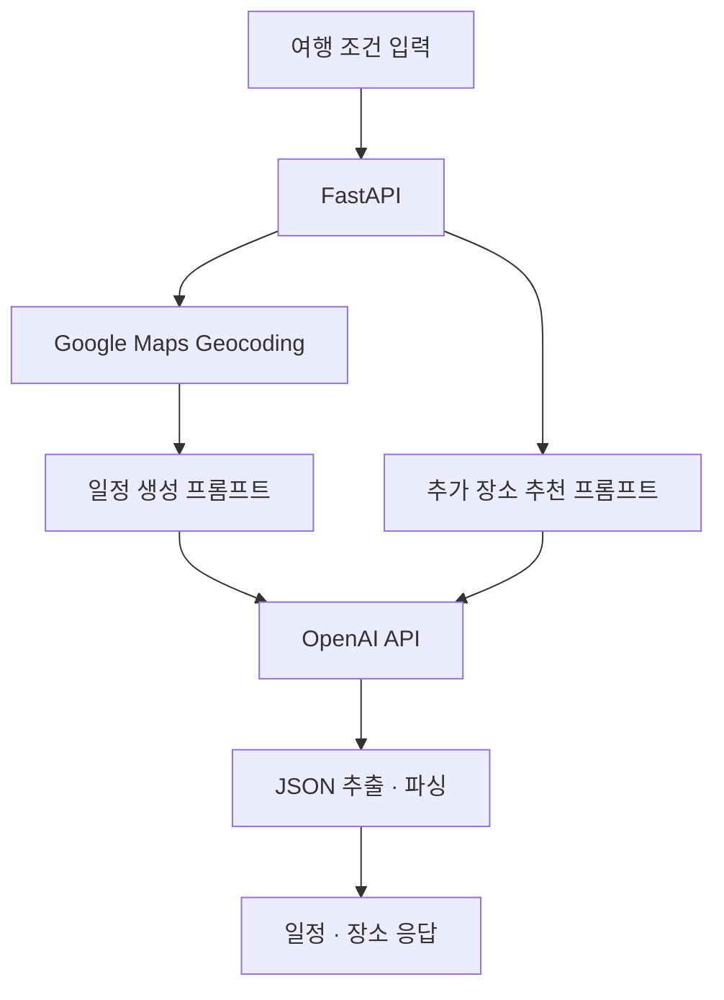

# Tripmate
### 사용자 조건 기반 여행 일정 생성 및 장소 추천 API

여행 도시, 테마, 동행자와 사용자가 추가한 장소를 입력받아 여행 일정을 생성하는 프로젝트입니다. **바쁜 일정과 여유로운 일정** 두 가지를 제공하고, 선택한 일정에 추가할 장소를 추천하는 API를 구성했습니다.

이 저장소에는 **FastAPI 기반 AI 서버 코드**가 포함되어 있습니다. 웹 화면·전체 서비스 백엔드·배포 설정은 이 저장소의 파일 목록에 포함되어 있지 않습니다.

## 주요 기능

| 기능 | 구현 내용 |
|---|---|
| 사용자 조건 반영 | 도시·기간·여행 테마·동행자·추가 장소를 프롬프트에 반영 |
| 두 가지 일정 생성 | 방문 장소가 많은 바쁜 일정과 상대적으로 여유로운 일정 생성 |
| 지도 표시용 응답 | 장소명·위도·경도·장소 유형을 포함하는 JSON 형식 요청 |
| 도시 위치 조회 | Google Maps Geocoding으로 입력 도시의 좌표 조회 |
| 추가 장소 추천 | 여행 조건에 맞는 명소·식당·카페 추천을 요청하는 엔드포인트 |
| 일정 공유 | 선택한 일정·추천 장소를 메모리에 저장하고 조회하는 엔드포인트 |

현재 장소 좌표·평점·리뷰 수와 이동 동선은 생성 결과에 대한 별도 검증이 없습니다. 프롬프트의 조건과 실제 장소 데이터의 검증은 구분됩니다.

## 시스템 구성



OpenAI 호출은 `utils/openai_client.py`에서 공통 처리합니다. 프롬프트 구성은 일정 생성과 추가 장소 추천 모듈로 나누었습니다.

## 일정 생성 방식

### 사용자 입력

- `selectedCity`: 여행 도시
- `days`: 기간 입력값. 현재 구현은 이 값에 1을 더한 일수의 일정을 생성합니다.
- `selectedTheme`: 자연·액티비티·관광지·문화·쇼핑 등 선택 테마
- `selectedGowith`: 동행자 유형
- `addedPlaces`: 일정에 포함하도록 요청할 사용자 추가 장소

### 프롬프트의 일정 조건

| 구분 | 요청 조건 |
|---|---|
| 공통 | 사용자 추가 장소 반영, 지리적으로 가까운 장소 묶기 |
| 일별 구성 | 식당 2곳 이상, 카페 1곳 이상 |
| 바쁜 일정 | 하루 7곳 이상 |
| 여유로운 일정 | 하루 5~6곳 |
| 응답 형식 | `busy_schedule`, `relaxed_schedule`을 포함하는 JSON |

위 조건은 모델에 전달하는 지시입니다. 현재 API가 모든 조건의 충족 여부를 검증하는 구조는 아닙니다. 지리적 묶음도 별도의 경로 최적화 알고리즘으로 계산하지 않습니다.

## 기술 스택

| 구분 | 기술 |
|---|---|
| API 서버 | Python, FastAPI |
| 일정·장소 생성 | OpenAI Python SDK, GPT-3.5-Turbo |
| 도시 위치 조회 | Google Maps API, googlemaps |
| 설정·응답 처리 | python-dotenv, Pydantic, JSON |

모델 식별자는 현재 `utils/openai_client.py`에 `gpt-3.5-turbo`로 지정되어 있습니다. 실행 시 계정에서 해당 모델을 사용할 수 있는지 확인하고, 변경할 경우 응답 형식도 함께 점검해야 합니다.

## 저장소 구조

Python 진입점과 프롬프트 파일은 저장소 최상위에 있고, 공통 유틸리티는 `utils/`에 있습니다.

| 경로 | 역할 |
|---|---|
| `main.py` | FastAPI 앱과 일정 생성·추천·공유 엔드포인트 |
| `prompt_generator.py` | 바쁜 일정·여유로운 일정 생성 프롬프트 |
| `prompt_recommendation.py` | 추가 장소 추천 프롬프트 |
| `utils/openai_client.py` | OpenAI 호출과 JSON 추출·파싱 |
| `utils/maps_client.py` | 장소 평점 필터·이름 추출 유틸리티 |

평점 필터 유틸리티는 현재 주요 일정 생성·추천 엔드포인트에 연결되어 있지 않습니다.

## 실행 준비

현재 저장소에는 의존성 명세 파일이 없습니다. 아래 패키지는 주요 import 기준의 설치 예시이며, 실행 환경의 버전 고정은 별도 정리가 필요합니다.

```bash
git clone https://github.com/Dongju-00/Tripmate.git
cd Tripmate

python -m venv .venv
source .venv/bin/activate

python -m pip install fastapi uvicorn openai googlemaps python-dotenv pydantic
```

코드에 `list[str]` 타입 표기가 있으므로 Python 3.9 이상을 사용합니다.

### 환경변수

`.env`에 실행용 값을 설정합니다.

```dotenv
OPENAI_API_KEY=<your-openai-api-key>
GOOGLE_MAPS_API_KEY=<your-google-maps-api-key>
```

### API 서버 실행

```bash
python -m uvicorn main:app --host 127.0.0.1 --port 8000
```

- API 문서: http://127.0.0.1:8000/docs
- 기본 화면 경로 `GET /`는 별도 HTML 파일을 읽습니다. 현재 저장소에는 해당 파일이 없어 화면까지 실행하려면 웹 리소스를 별도로 준비해야 합니다.

위 절차는 코드 구조에 따른 실행 안내입니다. 외부 API 호출을 포함한 전체 실행은 별도 환경에서 확인해야 합니다.

## API

| 메서드 | 경로 | 역할 |
|---|---|---|
| POST | `/get_prompt` | 사용자 조건으로 여행 일정 생성 |
| POST | `/ai_place_suggestions` | 추가 장소 추천 요청 |
| POST / GET | `/share_schedule` | 선택 일정 저장 / 조회 |
| POST / GET | `/share_aiplaces` | 추천 장소 저장 / 조회 |
| POST | `/api/calendar/submit` | 전달받은 캘린더 데이터 로깅 및 확인 응답 |

현재 `/api/calendar/submit`은 DB에 데이터를 저장하지 않습니다.

### POST /get_prompt

요청 예시:

```json
{
  "selectedCity": "부산",
  "days": 2,
  "selectedTheme": ["자연", "문화&역사&예술"],
  "selectedGowith": "친구들이랑",
  "addedPlaces": ["해운대 해수욕장", "감천문화마을"]
}
```

현재 코드에서 `days=2`는 `Schedule 1`부터 `Schedule 3`까지 생성하는 입력입니다. 프롬프트의 기간 표현과 API의 `days + 1` 처리를 일관되게 정리할 필요가 있습니다.

응답 구조 예시입니다. 실제 응답의 각 일별 배열에는 모델이 생성한 장소 목록이 들어갑니다.

```json
{
  "busy_schedule": {
    "Schedule 1": [],
    "Schedule 2": [],
    "Schedule 3": []
  },
  "relaxed_schedule": {
    "Schedule 1": [],
    "Schedule 2": [],
    "Schedule 3": []
  }
}
```

각 장소에 요청하는 형식:

```json
{
  "name": "장소명",
  "latitude": 35.0,
  "longitude": 129.0,
  "type": {
    "landmark": "명소"
  }
}
```

이 좌표는 형식을 보여주는 예시 값입니다. `type`은 명소·식당·카페에 따라 `landmark`, `restaurant`, `cafe`를 사용하도록 프롬프트에 지정합니다.

### POST /ai_place_suggestions

요청 예시:

```json
{
  "selectedCity": "부산",
  "selectedTheme": ["자연"],
  "selectedGowith": "친구들이랑",
  "selectedSchedules": []
}
```

현재 프롬프트는 명소·식당·카페 각각 10개, 평점 4.2 이상, 리뷰 75개 초과를 요청합니다. 다음 항목은 아직 보완이 필요합니다.

- 공통 OpenAI 함수가 반환한 `JSONResponse`를 엔드포인트에서 `json.loads()`에 전달하는 타입 불일치
- `selectedSchedules`를 함수 인자로 받지만 프롬프트에 실제 일정 내용을 삽입하지 않는 문제
- 추천 장소의 평점·리뷰 수·좌표에 대한 실제 장소 데이터 검증
- 추천 결과 키 `recommended_places `에 포함된 후행 공백 정리

따라서 이 엔드포인트는 현재 구현된 흐름과 수정이 필요한 상태를 함께 문서화했습니다.

## 설계에서 고려한 점

### 1. 일정 생성과 장소 추천 분리

전체 일정을 처음부터 만드는 작업과 기존 일정에 장소를 추가하는 작업을 별도 프롬프트 모듈로 나누었습니다.

### 2. 지도 표시를 위한 구조화된 응답

화면에서 장소를 표시할 수 있도록 이름·위도·경도·유형을 포함하는 JSON 형식을 요청합니다. 현재는 텍스트에서 JSON 객체를 정규식으로 추출하고 파싱하며, 스키마 검증은 후속 개선 항목입니다.

### 3. 사용자 선택권을 위한 두 가지 일정

같은 조건으로 바쁜 일정과 여유로운 일정을 함께 생성해 사용자가 여행 강도를 선택할 수 있도록 구성했습니다.

## 현재 한계와 개선 방향

- **응답 계약**: OpenAI 공통 함수는 데이터 객체를 반환하고, HTTP 응답은 엔드포인트에서 구성하도록 책임을 정리할 계획입니다.
- **데이터 분리**: 일정과 추천 장소가 같은 전역 `shared_schedule`을 사용합니다. 사용자별 저장·동시 요청·프로세스 재시작을 고려한 저장 구조가 필요합니다.
- **입력 검증**: 정의된 `PromptRequest`를 실제 요청 처리에 적용하고, 기간·테마·장소 입력을 검증할 계획입니다.
- **장소 검증**: 생성된 장소를 실제 Places 데이터와 대조하고 중복·좌표·운영 여부를 확인할 계획입니다.
- **외부 호출**: `async` 엔드포인트 안의 동기 API 호출을 분리하고, 타임아웃과 실패 응답을 정리할 계획입니다.
- **배포·재현성**: 의존성 버전, 웹 리소스, 실행 및 배포 구성을 정리할 계획입니다.

## 프로젝트 범위

현재 저장소는 여행 추천 서비스의 AI API 부분을 보여줍니다. 전체 서비스의 백엔드·화면·팀별 기여 범위는 해당 자료를 연결해 별도로 설명할 수 있습니다.
